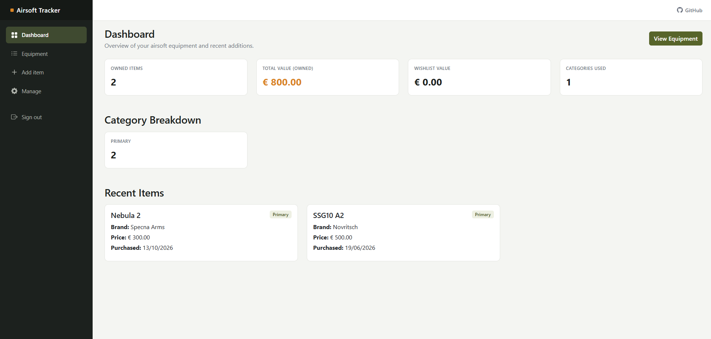
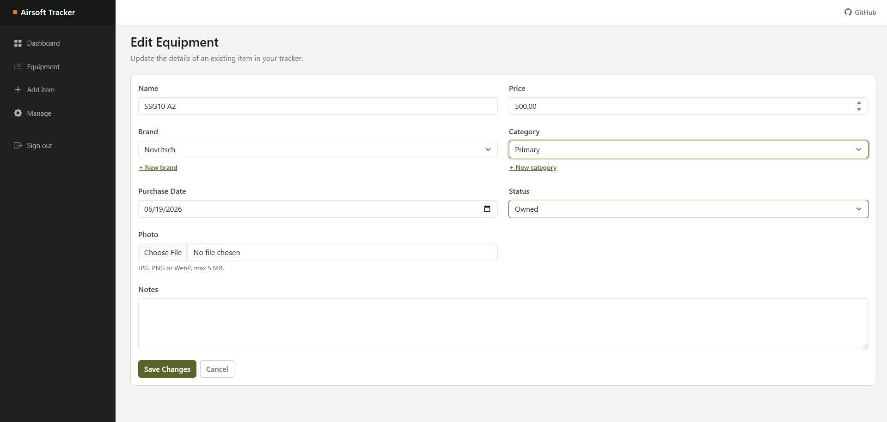

# Airsoft Equipment Tracker

[](https://github.com/xandermeyen/AirsoftEquipmentTracker/actions/workflows/ci.yml)


A web app I built to keep track of my airsoft gear: replicas, attachments, magazines and the rest. Every user gets their own account and inventory. You can add items with a photo, track whether you own, sold or still want something, and see at a glance what your gear is worth.

It started as a way to practice full-stack .NET properly, end to end, instead of following along with tutorials. So next to being a useful little tool, it's the project I point to when someone asks what I can build.

| Dashboard | Add / edit equipment |
| --- | --- |
|  |  |

## What it does

- **Accounts**: register, log in, log out and reset your password with ASP.NET Core Identity. Reset links expire after 30 minutes. Every page requires login and every user only sees their own items.
- **Dashboard**: number of owned items, total value, wishlist value, a per-category breakdown and the most recent additions
- **Equipment overview**: search by name or brand, filter by category and status, and sort the list
- **Full CRUD**: add, edit and delete items, with a confirmation step before anything gets removed
- **Status per item**: Owned, Sold or Wishlist. Only owned items count towards the totals, the wishlist gets its own number.
- **Photos**: upload a JPG, PNG or WebP (max 5 MB) per item, stored under a GUID name and cleaned up when replaced or deleted
- **Validation**: field-level messages, price between 0 and 100,000, and a custom `[NotInFuture]` attribute for the purchase date
- **Brands and categories**: add them straight from the item form, or rename and delete them on a separate manage page. Anything still in use can't be deleted.

## Tech stack

- Blazor Server (.NET 10), Interactive Server render mode
- C#
- ASP.NET Core Identity for authentication
- Entity Framework Core 10 with SQL Server (running in Docker)
- xUnit with SQLite in-memory for tests
- GitHub Actions for build and test on every push and pull request
- Bootstrap for the layout, with a custom theme on top

## How it's put together

The solution has a Blazor Server app and a Web API that share the same data and logic:

**`AirsoftEquipmentTracker.Core`** has the domain models and no package dependencies at all.
- `EquipmentItem`, `Brand`, `Category`, the `EquipmentStatus` enum, the `NotInFutureAttribute` validator, `DashboardStats` and `AppRoles`.
- An item only stores the `UserId` of its owner, so Core doesn't need to know about Identity.
- `Interfaces/` has `IEquipmentService` and `IImageService`. The Blazor app and the API depend on these, not on the implementations, so they can be mocked in tests.

**`AirsoftEquipmentTracker.Infrastructure`** has everything that touches the database or the file system.
- `Data/AppDbContext.cs` extends `IdentityDbContext`, configures the relationships and seeds brands and categories. Items point at a brand and a category with `DeleteBehavior.Restrict`, so you can't delete a brand or category that's still in use.
- `Identity/ApplicationUser.cs` is the Identity user, and `IdentityConfig.cs` holds the password rules both apps use.
- `Services/EquipmentService.cs` is the only thing the pages talk to for data. Every item query is scoped to the logged-in user, and it also calculates the dashboard numbers. It uses `IDbContextFactory` rather than a single injected context, which is the recommended approach for Blazor Server because components live longer than a normal request.
- `Services/ImageService.cs` validates, saves and deletes uploaded photos. It works on a plain `Stream`, so it isn't tied to Blazor.
- `Migrations/` has the EF Core migrations.
- `DependencyInjection.cs` registers all of the above with one `AddInfrastructure(...)` call.

**`AirsoftEquipmentTracker`** is the Blazor Server app.
- `Components/Pages/` contains the Blazor pages: Dashboard, the equipment list, the add/edit form and the brand and category manager.
- `Pages/Account/` holds the Razor Pages for login, register, logout and the forgot/reset password flow. These run outside the Blazor circuit because the auth cookie has to be set on a normal HTTP request.

**`AirsoftEquipmentTracker.Api`** is an ASP.NET Core Web API on top of the same services.
- Authentication with JWT: `POST /api/auth/register`, `POST /api/auth/login` (returns a token) and `GET /api/auth/me`.
- `TokenService` creates the tokens; the settings are validated at startup, so a missing or too short secret fails right away.
- `GlobalExceptionHandler` turns exceptions into JSON responses with the right status code.
- In development, `/scalar` has an interactive API reference, and `AirsoftEquipmentTracker.Api.http` has ready-made test requests.

I deliberately didn't add a generic repository and unit of work on top of EF Core. `DbContext` already is a unit of work, and Blazor Server needs `IDbContextFactory` with short-lived contexts, which doesn't fit a unit of work that holds one context for the whole request. `EquipmentService` plays the role of the service layer instead.

Brands and categories are shared between all users, so only accounts with the `Admin` role can rename or delete them. Everyone can still add new ones from the equipment form.

The connection string lives in user-secrets, not in `appsettings.json`, so no credentials end up in the repo.

## Tests

`AirsoftEquipmentTracker.Tests` covers `EquipmentService` against a real SQLite in-memory database, so relationships and constraints behave like they do in production. Among other things it checks:

- adding, updating and deleting items
- that a user can't read, update or delete someone else's items
- that brands and categories are deduplicated and trimmed
- that a brand or category in use can't be deleted or renamed to a duplicate
- the dashboard numbers

`ImageService` has its own tests for validation, saving and deleting, including a check that a path with `../` can't delete files outside the uploads folder.

Run them with:

```bash
dotnet test
```

## Running it locally

You'll need the .NET 10 SDK and Docker.

1. Start SQL Server in a container:

   ```bash
   docker run -e "ACCEPT_EULA=Y" -e "MSSQL_SA_PASSWORD=Your_password123" \
     -p 1433:1433 --name airsoft-sql -d mcr.microsoft.com/mssql/server:2022-latest
   ```

2. From the `AirsoftEquipmentTracker` folder, set the connection string in user-secrets:

   ```bash
   dotnet user-secrets set "ConnectionStrings:DefaultConnection" \
     "Server=localhost,1433;Database=AirsoftTracker;User Id=sa;Password=Your_password123;TrustServerCertificate=True"
   ```

   To make your own account an admin (needed to manage brands and categories), add your email too:

   ```bash
   dotnet user-secrets set "AdminEmail" "you@example.com"
   ```

3. From the repository root, apply the migrations to create the database. The migrations live in the Infrastructure project, so EF needs both projects:

   ```bash
   dotnet ef database update --project AirsoftEquipmentTracker.Infrastructure --startup-project AirsoftEquipmentTracker
   ```

4. From the `AirsoftEquipmentTracker` folder, run the app:

   ```bash
   dotnet run
   ```

Open the URL the console prints and register an account. Brands and categories are already seeded, so you can start adding gear right away.

### Running the API

The API shares its user-secrets with the Blazor app, so the connection string and `AdminEmail` are already there. It only needs a secret for signing tokens (at least 32 characters):

```bash
dotnet user-secrets set "Jwt:Secret" "<a long random string>" --project AirsoftEquipmentTracker.Api
dotnet run --project AirsoftEquipmentTracker.Api
```

Then open `/scalar` on the URL the console prints for the API reference.

## What I learned

This is where most of the value was for me:

- Setting up EF Core from scratch: the DbContext, relationships, migrations and seeding, and why foreign-key delete behaviour matters
- Why Blazor Server wants `IDbContextFactory` instead of a scoped context, and what goes wrong if you ignore that
- Adding Identity to an existing Blazor app, and why login and logout need Razor Pages instead of Blazor components
- Scoping all data per user in the service layer instead of trusting the UI
- Handling file uploads safely: checking type and size, and never trusting the original file name
- Writing custom validation attributes and showing field-level messages in `EditForm`
- Testing the data layer against SQLite in-memory instead of mocking everything away

## Ideas for later

- A proper loadouts feature, grouping items into kits
- Maintenance log per replica
- Sending the password reset link by email (for now it's logged to the console in development)
- Email confirmation on registration
- Export to CSV

## License

MIT, see [LICENSE](LICENSE).

## Author

Xander Meyen · [xandermeyen.be](https://xandermeyen.be)
